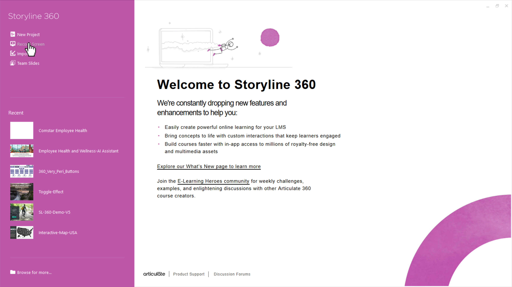
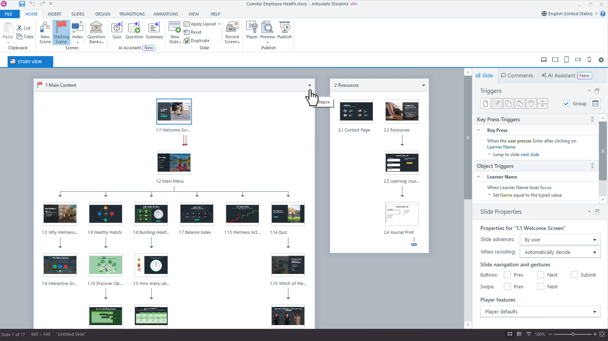
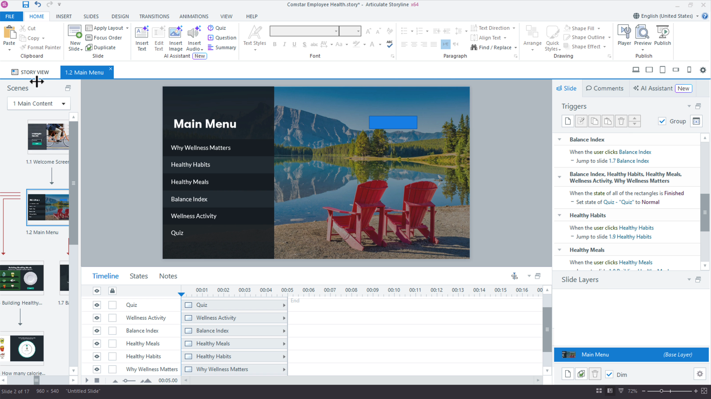

# Activity 01 — Start the Safety Module and Storyboard

**Course:** Mastering Articulate Storyline 360 for e-Learning Content Creation (`TGS-2024042308`)
**Version:** v11 · 17 October 2026

## Scenario

HarbourLink Logistics needs an 8–10 minute annual WSH refresher for frontline warehouse operators, including learners with low reading confidence. Build a picture-first module with short plain-English labels, narration, captions, purposeful interaction, keyboard equivalents and a five-question 80% practice quiz.

## Objective

Create the local source baseline, five-scene architecture and traceable storyboard.

## Supplied files and checkpoint

- Continue from/save as `HarbourLink-WSH-Checkpoint-01-YourName.story`.
- Shared runnable assets are under `../source/`.
- A completed `.story` solution is not supplied; build and test the project in Storyline 360 on Windows.

## Detailed procedure

1. Create a new blank Storyline project and save it as `HarbourLink-WSH-Checkpoint-01-YourName.story` on a local Windows drive. No completed .story solution is supplied.

*Figure 1.1 — Step 1: New Project start screen. Authentic Articulate tutorial/product guidance; example values may differ, so verify the named control in your own checkpoint.*

2. Open `source/storyboard.csv` and the previous checkpoint, then confirm the screen IDs and acceptance criteria before editing.
3. In Story View, create and name scenes `01 Welcome`, `02 Learn`, `03 Practise`, `04 Quiz`, and `05 Resources`; set Welcome as the starting scene.

*Figure 1.2 — Step 3: Story View scenes and navigation. Authentic Articulate tutorial/product guidance; example values may differ, so verify the named control in your own checkpoint.*

4. Import `source/storyboard.csv` into your working notes and create the listed placeholder slides with matching screen IDs.

*Figure 1.3 — Step 4: Slide View workspace. Authentic Articulate tutorial/product guidance; example values may differ, so verify the named control in your own checkpoint.*

5. Choose Design > Slide Size > 16:9 (960 × 540) before placing content; record the exact dimensions in the build log.
6. Create a variable register in project notes for `HazardsFound` (Number, 0), seven hazard flags (True/False, False), `RiskLevel` (Number, 1), and `LearnerName` (Text, blank).
7. Preview the entire project and confirm every scene has an intentional entry and return path.

## Evidence to retain

Retain the named .story checkpoint, the completed self-check table and one screenshot for each task showing the final state or setting that proves the acceptance criteria.

## Acceptance criteria

- [ ] Five named scenes and storyboard IDs match.
- [ ] Variables use the specified type and default.
- [ ] Source and checkpoint are versioned locally.
- [ ] Whole-project preview has no dead end.

## Reflection prompts

- Which storyboard or audience requirement drove your most important decision?
- Which Storyline panel, trigger or setting proves that decision is implemented?
- What accessibility, rights or publishing evidence must accompany the finished project?
