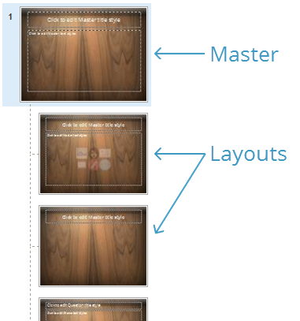
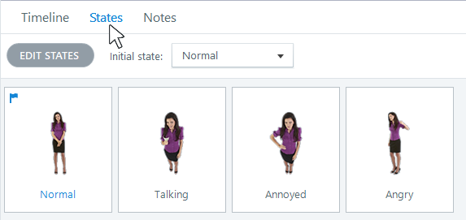

# Activity 02 — Build Theme, Masters and Menu

**Course:** Mastering Articulate Storyline 360 for e-Learning Content Creation (`TGS-2024042308`)
**Version:** v11 · 17 October 2026

## Scenario

HarbourLink Logistics needs an 8–10 minute annual WSH refresher for frontline warehouse operators, including learners with low reading confidence. Build a picture-first module with short plain-English labels, narration, captions, purposeful interaction, keyboard equivalents and a five-question 80% practice quiz.

## Objective

Create reusable visual layouts and accessible scene navigation.

## Supplied files and checkpoint

- Continue from/save as `HarbourLink-WSH-Checkpoint-02-YourName.story`.
- Shared runnable assets are under `../source/`.
- A completed `.story` solution is not supplied; build and test the project in Storyline 360 on Windows.

## Detailed procedure

1. Open `HarbourLink-WSH-Checkpoint-01-YourName.story` from the previous activity and immediately use File > Save As to create `HarbourLink-WSH-Checkpoint-02-YourName.story` on a local Windows drive. Preserve the prior checkpoint; no completed .story solution is supplied.
2. Open `source/storyboard.csv` and the previous checkpoint, then confirm the screen IDs and acceptance criteria before editing.
3. Choose Design > Fonts > Create New Theme Fonts and Design > Colors > Create New Theme Colors from `source/style-guide.md`; then use Design > Themes to save the combined HarbourLink theme.

*Figure 2.1 — Step 3: View > Slide Master layouts and master panel. Authentic Articulate tutorial/product guidance; example values may differ, so verify the named control in your own checkpoint.*

4. Open View > Slide Master and build title, content, scenario and quiz layouts; keep course-specific text off the master.
5. On the menu slide, add four labelled buttons with Normal, Hover, Visited and Disabled states.
6. Add explicit Jump to slide triggers for Learn, Practise, Quiz and Resources; name each button and check Focus Order.

*Figure 2.2 — Step 6: States panel for menu controls. Authentic Articulate tutorial/product guidance; example values may differ, so verify the named control in your own checkpoint.*

7. Test Tab, Shift+Tab, Enter and Space, then verify each destination returns to the menu.

## Evidence to retain

Retain the named .story checkpoint, the completed self-check table and one screenshot for each task showing the final state or setting that proves the acceptance criteria.

## Acceptance criteria

- [ ] Four reusable layouts inherit correctly.
- [ ] Theme values match the style guide.
- [ ] Menu routes and returns correctly.
- [ ] Keyboard focus and state changes are visible.

## Reflection prompts

- Which storyboard or audience requirement drove your most important decision?
- Which Storyline panel, trigger or setting proves that decision is implemented?
- What accessibility, rights or publishing evidence must accompany the finished project?
