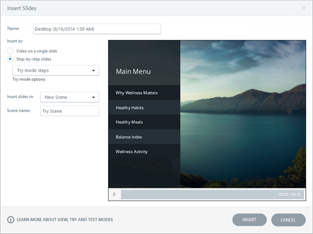
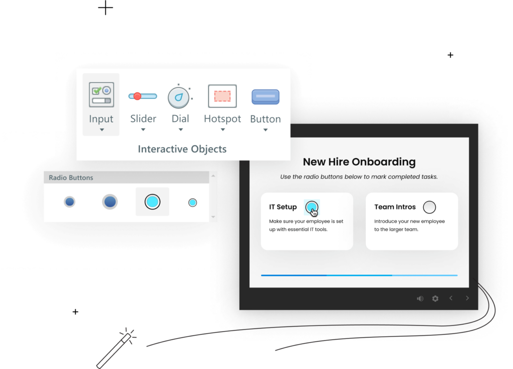

# Activity 03 — Add Media and Hazard Scene

**Course:** Mastering Articulate Storyline 360 for e-Learning Content Creation (`TGS-2024042308`)
**Version:** v11 · 17 October 2026

## Scenario

HarbourLink Logistics needs an 8–10 minute annual WSH refresher for frontline warehouse operators, including learners with low reading confidence. Build a picture-first module with short plain-English labels, narration, captions, purposeful interaction, keyboard equivalents and a five-question 80% practice quiz.

## Objective

Construct the warehouse visual with rights-aware media and seven meaningful hazards.

## Supplied files and checkpoint

- Continue from/save as `HarbourLink-WSH-Checkpoint-03-YourName.story`.
- Shared runnable assets are under `../source/`.
- A completed `.story` solution is not supplied; build and test the project in Storyline 360 on Windows.

## Detailed procedure

1. Open the previous checkpoint and File > Save As `HarbourLink-WSH-Checkpoint-03-YourName.story`.
2. In Story View open scene `02 Learn`; open the existing storyboard placeholder `WSA-101 Hazard Walkthrough` and replace its placeholder content without creating a duplicate slide ID.
3. In Slide View choose Insert > Picture, browse to `activities/source/warehouse-seven-hazards.png`, and select Insert.

*Figure 3.1 — Step 3: Insert ribbon > Picture from file. Authentic Articulate tutorial/product guidance; example values may differ, so verify the named control in your own checkpoint.*

4. Choose Picture Tools — Format > Crop; drag the crop handles without stretching until all seven hazards remain visible, then click Crop again to finish.
5. Right-click the picture > Accessibility; enter alt text describing the unsafe warehouse inspection scene.
6. Open View > Media Library; rename the asset `img_WarehouseHazards` and record the source in the evidence sheet.
7. Choose Insert > Hotspot; draw a non-overlapping region over the forklift route.

*Figure 3.2 — Step 7: Insert > Hotspot for seven targets. Authentic Articulate tutorial/product guidance; example values may differ, so verify the named control in your own checkpoint.*

8. Duplicate and reposition hotspots for blocked exit, spill, unstable stack, missing PPE, trailing cable and fire-door obstruction.
9. In Timeline rename them `hs_Hazard01` through `hs_Hazard07`; extend every hotspot to the full slide duration.
10. Insert seven visible numbered buttons and rename them `btn_Hazard01` through `btn_Hazard07`.
11. Open States > Edit States; add visible Hover, Down and Visited treatments that use icon/text as well as colour.
12. Open Focus Order; remove decorative objects and place the seven buttons in logical warehouse order.
13. Preview This Slide; operate all seven buttons by Tab and Enter, then repeat with pointer hotspots.
14. Check at player size that no target overlaps and every hazard remains visible.
15. Save, close, reopen and retain one screenshot showing the final hazard slide plus named Timeline objects.

## Evidence to retain

Retain the named .story checkpoint, the completed self-check table and one screenshot for each task showing the final state or setting that proves the acceptance criteria.

## Acceptance criteria

- [ ] Seven hazards are visually plausible.
- [ ] Media retains aspect ratio and provenance.
- [ ] Hotspots do not overlap.
- [ ] Visible keyboard alternatives map one-to-one.

## Reflection prompts

- Which storyboard or audience requirement drove your most important decision?
- Which Storyline panel, trigger or setting proves that decision is implemented?
- What accessibility, rights or publishing evidence must accompany the finished project?
