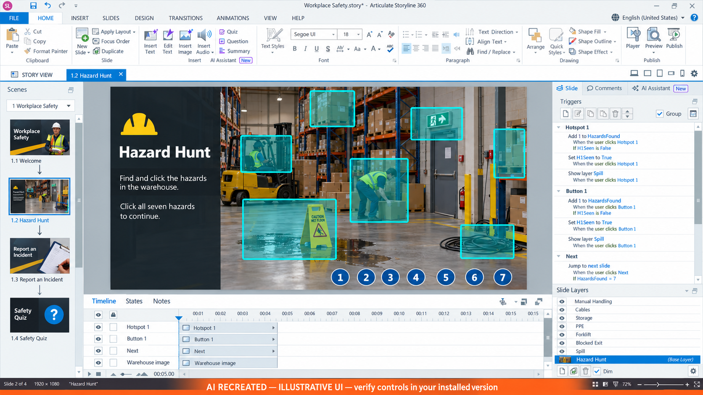
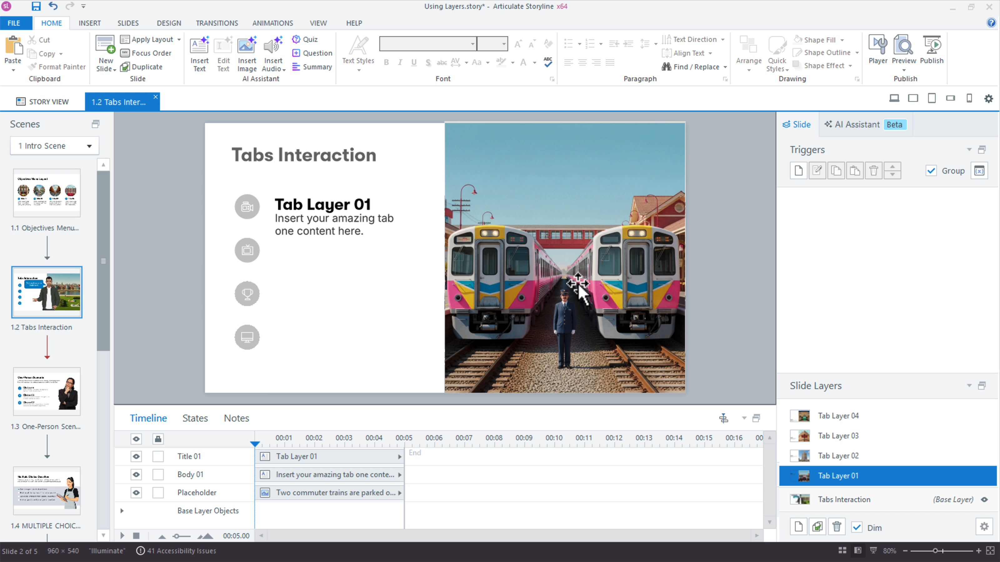
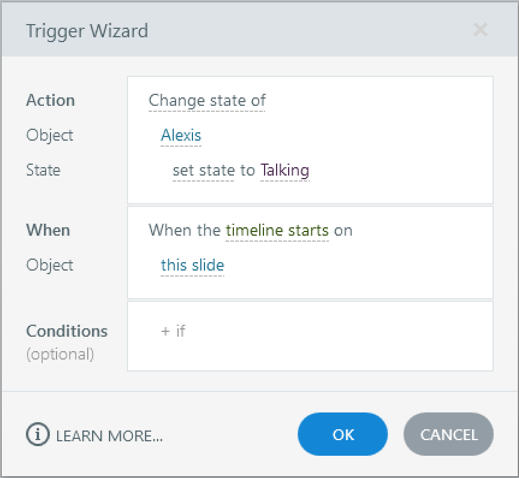
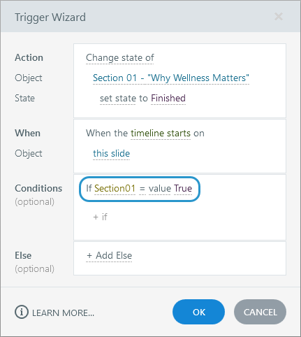

# Activity 04 — Add Layers, States, Variables and Gate

**Course:** Mastering Articulate Storyline 360 for e-Learning Content Creation (`TGS-2024042308`)
**Version:** v11 · 17 October 2026

## Scenario

HarbourLink Logistics needs an 8–10 minute annual WSH refresher for frontline warehouse operators, including learners with low reading confidence. Build a picture-first module with short plain-English labels, narration, captions, purposeful interaction, keyboard equivalents and a five-question 80% practice quiz.

## Objective

Make hazard discovery accessible, persistent and completion-gated.

## Supplied files and checkpoint

- Continue from/save as `HarbourLink-WSH-Checkpoint-04-YourName.story`.
- Shared runnable assets are under `../source/`.
- A completed `.story` solution is not supplied; build and test the project in Storyline 360 on Windows.

## Detailed procedure

1. Open `HarbourLink-WSH-Checkpoint-03-YourName.story`; File > Save As `HarbourLink-WSH-Checkpoint-04-YourName.story`.
2. In the Triggers panel click the Manage project variables icon. Create Number `HazardsFound` with default `0`.
3. Create True/False variables `Hazard01Found` through `Hazard07Found`, each default `False`.
4. Open Slide Layers > New Layer; create `lyr_Hazard01` through `lyr_Hazard07` before creating any Show layer trigger.

*Figure 4.1 — Step 4: AI RECREATED full hazard editor orientation. AI RECREATED illustrative orientation; example values may differ, so verify the named control in your own checkpoint.*

*Figure 4.2 — Step 4: Full Slide View with Layers panel; create lyr_Hazard01–07. Authentic Articulate tutorial/product guidance; example values may differ, so verify the named control in your own checkpoint.*

5. On every hazard layer, first add title text (for example `Forklift route hazard`) and body text describing risk and control.
6. Open layer Properties, enable Present as Dialog, then choose the existing title text in the Dialog Label dropdown and body text in Dialog Description. Add a labelled Close button, set it to Hide this layer, and verify automatic focus trapping/return.
7. Create `lyr_Incomplete` now, with instructions to find all seven hazards and a Close button.
8. Select `hs_Hazard01`; in Triggers choose Create a new trigger.
9. Set Action `Adjust variable`, Variable `HazardsFound`, Operator `Add`, Value `1`, Event `When user clicks`, Object `hs_Hazard01`, Condition `Hazard01Found == False`.

*Figure 4.3 — Step 9: Trigger Wizard ordered Adjust variable trigger. Authentic Articulate tutorial/product guidance; example values may differ, so verify the named control in your own checkpoint.*

*Figure 4.4 — Step 9: Hazard01Found == False guard. Authentic Articulate tutorial/product guidance; example values may differ, so verify the named control in your own checkpoint.*

10. Add second same-click trigger: set `Hazard01Found` to `True` only if it equals False.
11. Add third trigger: change `btn_Hazard01` to `Visited`; add fourth: Show layer `lyr_Hazard01`. Keep this exact order.
12. Copy the same ordered four triggers to `btn_Hazard01`; edit every trigger event object to `btn_Hazard01` and keep the same flag condition so keyboard and hotspot paths share the counter.
13. Mirror both hotspot and button trigger sets for hazards 02–07, changing object, flag, button and layer names consistently.
14. Insert text `%HazardsFound% of 7 found`; give it the accessible name `Hazard discovery progress`.
15. On Next add Jump to next slide when HazardsFound equals 7; below it add Show layer `lyr_Incomplete` when HazardsFound is less than 7.
16. Preview the hotspot path and the visible-button keyboard path; each unique hazard must increment once and open the same layer.
17. Click one hotspot then its matching button; confirm the counter stays 1.
18. Select six hazards and confirm Next shows `lyr_Incomplete`; select the seventh and confirm progression.
19. Open every Dialog layer by keyboard, close it and verify focus returns to the invoking numbered button.
20. Save, close, reopen and capture Manage Variables, one hotspot trigger group, one button trigger group, Dialog properties, condition and 7-of-7 runtime state.

## Evidence to retain

Retain the named .story checkpoint, the completed self-check table and one screenshot for each task showing the final state or setting that proves the acceptance criteria.

## Acceptance criteria

- [ ] Counter never exceeds seven.
- [ ] Repeated selections do not inflate progress.
- [ ] Six hazards block and seven permit progression.
- [ ] Pointer and keyboard paths show identical content.

## Reflection prompts

- Which storyboard or audience requirement drove your most important decision?
- Which Storyline panel, trigger or setting proves that decision is implemented?
- What accessibility, rights or publishing evidence must accompany the finished project?
