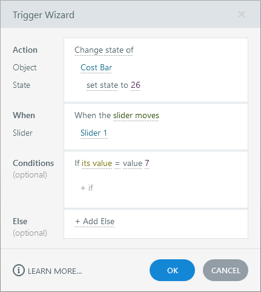
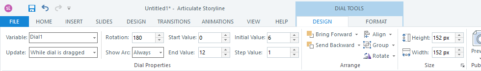
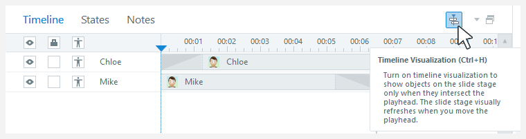

# Activity 05 — Build Motion, Slider and Dial Controls

**Course:** Mastering Articulate Storyline 360 for e-Learning Content Creation (`TGS-2024042308`)
**Version:** v11 · 17 October 2026

## Scenario

HarbourLink Logistics needs an 8–10 minute annual WSH refresher for frontline warehouse operators, including learners with low reading confidence. Build a picture-first module with short plain-English labels, narration, captions, purposeful interaction, keyboard equivalents and a five-question 80% practice quiz.

## Objective

Use motion and data controls to explain dynamic workplace risk.

## Supplied files and checkpoint

- Continue from/save as `HarbourLink-WSH-Checkpoint-05-YourName.story`.
- Shared runnable assets are under `../source/`.
- A completed `.story` solution is not supplied; build and test the project in Storyline 360 on Windows.

## Detailed procedure

1. Open HarbourLink-WSH-Checkpoint-04 and Save As HarbourLink-WSH-Checkpoint-05-YourName.story.
2. In the Triggers panel choose Manage project variables; create Number `RiskLevel` with default `1` and Number `RiskZone` with default `1`.
3. Insert a slider on the risk screen; select Slider Tools — Design and set Start `1`, End `5`, Initial `1`, Step `1`.
4. In Slider Tools — Design > Variable bind the slider to `RiskLevel`.

*Figure 5.1 — Step 4: Slider moves trigger and value condition. Authentic Articulate tutorial/product guidance; example values may differ, so verify the named control in your own checkpoint.*

5. Create `lyr_RiskLow`, `lyr_RiskMedium`, and `lyr_RiskHigh` before selecting any layer in a trigger.
6. Create slider-moves triggers: show Low when RiskLevel is 1–2, Medium when 3, and High when 4–5; order the conditions so only one layer opens.

*Figure 5.2 — Step 6: Dial Tools — Design: RiskZone variable, start/end/step values. Authentic Articulate tutorial/product guidance; example values may differ, so verify the named control in your own checkpoint.*

7. Insert a dial and bind its variable to `RiskZone`; set Start `1`, End `3`, Initial `1`, Step `1`.
8. Create `lyr_Zone01`, `lyr_Zone02`, and `lyr_Zone03` before adding dial-moves triggers.

*Figure 5.3 — Step 8: Timeline duration and object visibility. Authentic Articulate tutorial/product guidance; example values may differ, so verify the named control in your own checkpoint.*

9. Add one dial-moves trigger per exact RiskZone value; show the matching zone layer and hide the other two.
10. Add a motion path to the forklift icon; trigger it only after the learner confirms the route is clear.
11. Provide visible Previous/Next value buttons as keyboard alternatives for both slider and dial.
12. Set the interactive objects to remain visible for the full slide duration in Timeline.
13. Preview values 1, 3, and 5 plus all three zones; compare visible value, variable readback, layer, and keyboard path.
14. Revisit the slide and verify the specified resume/reset behaviour.
15. Save and retain Slider Tools values, variable bindings, layer list, trigger conditions, and three runtime states.

## Evidence to retain

Retain the named .story checkpoint, the completed self-check table and one screenshot for each task showing the final state or setting that proves the acceptance criteria.

## Acceptance criteria

- [ ] Motion is learner-controlled.
- [ ] All slider values have text equivalents.
- [ ] Every dial detent maps to one zone.
- [ ] Revisit matches the specification.

## Reflection prompts

- Which storyboard or audience requirement drove your most important decision?
- Which Storyline panel, trigger or setting proves that decision is implemented?
- What accessibility, rights or publishing evidence must accompany the finished project?
