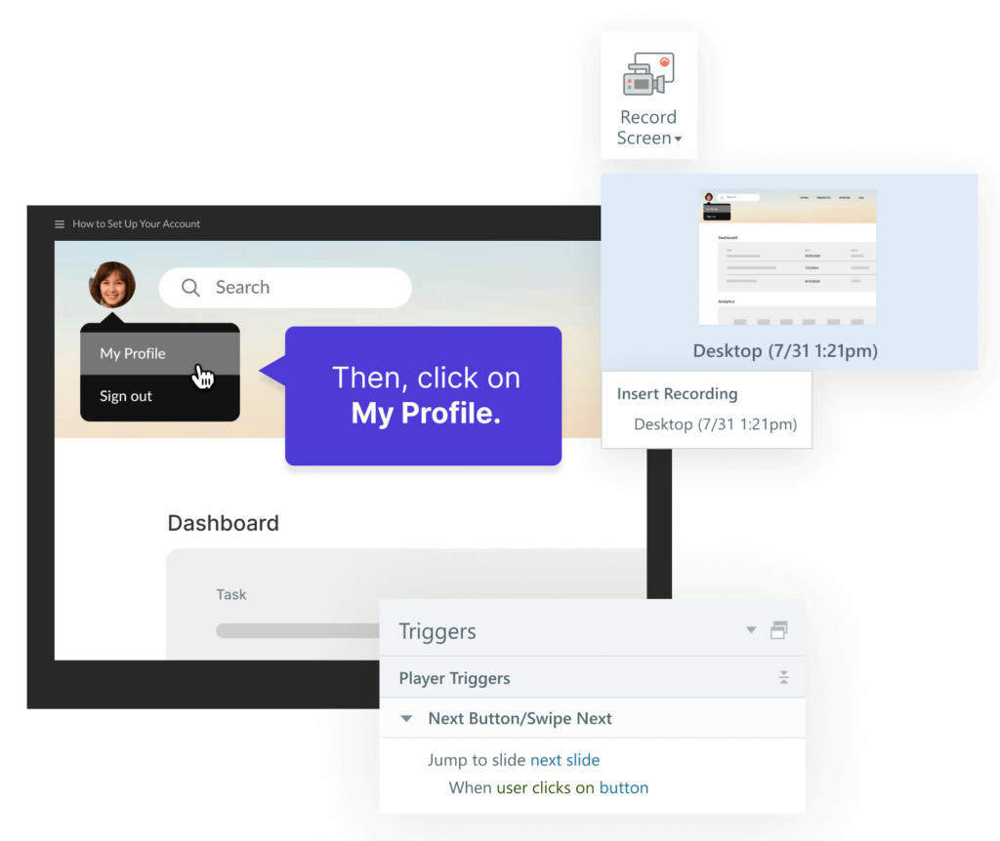

# Activity 06 — Create View, Try and Test Simulations

**Course:** Mastering Articulate Storyline 360 for e-Learning Content Creation (`TGS-2024042308`)
**Version:** v11 · 17 October 2026

## Scenario

HarbourLink Logistics needs an 8–10 minute annual WSH refresher for frontline warehouse operators, including learners with low reading confidence. Build a picture-first module with short plain-English labels, narration, captions, purposeful interaction, keyboard equivalents and a five-question 80% practice quiz.

## Objective

Capture and deploy the supplied incident-report simulation in three Storyline modes.

## Supplied files and checkpoint

- Continue from/save as `HarbourLink-WSH-Checkpoint-06-YourName.story`.
- Shared runnable assets are under `../source/`.
- A completed `.story` solution is not supplied; build and test the project in Storyline 360 on Windows.

## Detailed procedure

1. Open `HarbourLink-WSH-Checkpoint-05-YourName.story` from the previous activity and immediately use File > Save As to create `HarbourLink-WSH-Checkpoint-06-YourName.story` on a local Windows drive. Preserve the prior checkpoint; no completed .story solution is supplied.
2. Open `source/storyboard.csv` and the previous checkpoint, then confirm the screen IDs and acceptance criteria before editing.
3. Open `source/incident-report/index.html`, use fictional data only, silence notifications and rehearse the submit path.

*Figure 6.1 — Step 3: Slides > Record Screen entry. Authentic Articulate tutorial/product guidance; example values may differ, so verify the named control in your own checkpoint.*

4. Record a readable bounded region with Slides > Record Screen.
5. Insert one copy as Video on a Single Slide and add learner playback controls.
6. Insert a second copy as Try Mode; edit hotspots and coaching so intended actions advance and wrong actions receive guidance.
7. Insert a third copy as Test Mode; configure score and attempts, then test correct and incorrect action paths.

*Figure 6.2 — Step 7: Try/Test recording trigger structure. Authentic Articulate tutorial/product guidance; example values may differ, so verify the named control in your own checkpoint.*

## Evidence to retain

Retain the named .story checkpoint, the completed self-check table and one screenshot for each task showing the final state or setting that proves the acceptance criteria.

## Acceptance criteria

- [ ] Recording exposes no private data.
- [ ] View mode can pause and seek.
- [ ] Try mode coaches wrong actions.
- [ ] Test mode scores specified actions.

## Reflection prompts

- Which storyboard or audience requirement drove your most important decision?
- Which Storyline panel, trigger or setting proves that decision is implemented?
- What accessibility, rights or publishing evidence must accompany the finished project?
