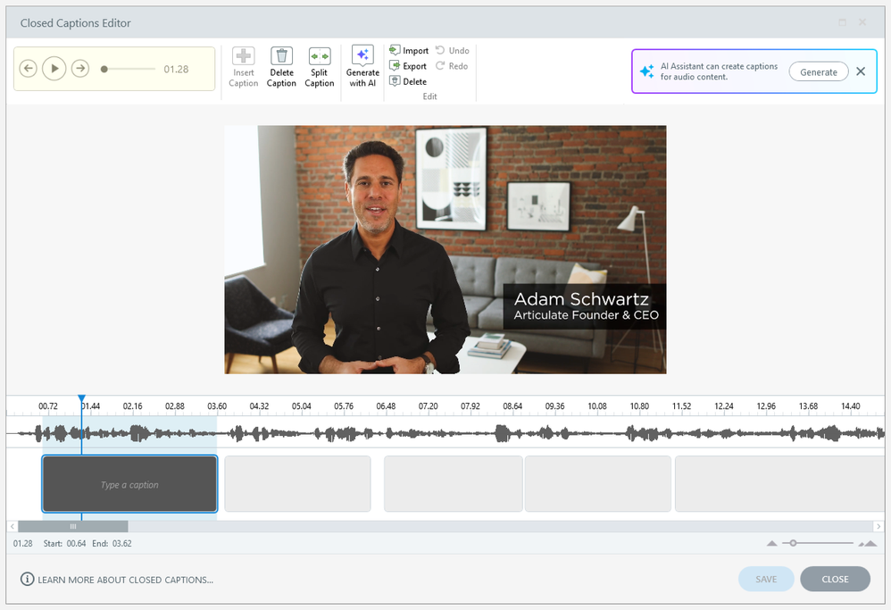
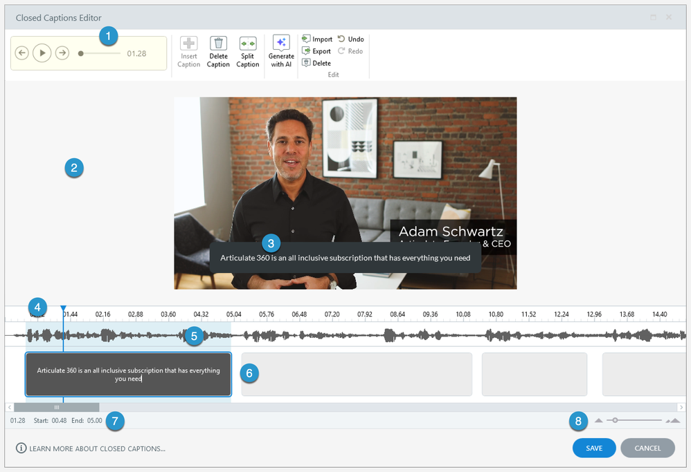

# Activity 07 — Add Audio, Captions and Accessibility

**Course:** Mastering Articulate Storyline 360 for e-Learning Content Creation (`TGS-2024042308`)
**Version:** v11 · 17 October 2026

## Scenario

HarbourLink Logistics needs an 8–10 minute annual WSH refresher for frontline warehouse operators, including learners with low reading confidence. Build a picture-first module with short plain-English labels, narration, captions, purposeful interaction, keyboard equivalents and a five-question 80% practice quiz.

## Objective

Add the supplied eight-scene HarbourLink annual WSH narration with one matching MP3/VTT pair per screen, equivalent transcript and keyboard-operable Replay/Stop controls.

## Supplied files and checkpoint

- Continue from/save as `HarbourLink-WSH-Checkpoint-07-YourName.story`.
- Shared runnable assets are under `../source/`.
- A completed `.story` solution is not supplied; build and test the project in Storyline 360 on Windows.

## Detailed procedure

1. Open HarbourLink-WSH-Checkpoint-06 and Save As HarbourLink-WSH-Checkpoint-07-YourName.story.
2. In scene `02 Learn`, confirm storyboard screens `HLL-VO-01` through `HLL-VO-08` exist in order; create none with duplicate IDs.
3. For each screen 01–08, choose Insert > Audio > Audio from File and import the matching `activities/source/narration/harbourlink-scene-01.mp3` through `harbourlink-scene-08.mp3`; place exactly one clip on its matching screen.
4. Rename each Timeline audio object `aud_HLL_01` through `aud_HLL_08`; do not repeat the 201.67-second combined track on every screen.
5. On each screen select its audio object, choose Options > Import (or Accessibility > Import CC), and import the matching `activities/source/captions/harbourlink-scene-01.vtt` through `harbourlink-scene-08.vtt`.

*Figure 7.1 — Step 5: Import matching VTT for selected audio. Authentic Articulate tutorial/product guidance; example values may differ, so verify the named control in your own checkpoint.*

6. Compare the eight screen IDs, MP3 filenames and VTT filenames against `activities/source/storyboard.csv` and `activities/source/narration/harbourlink-audio-manifest.json`.
7. Add labelled Replay and Stop controls on every narrated screen; Replay restarts only that screen's clip and Stop stops only that clip.
8. Link `activities/source/narration/annual-wsh-script.md` as the transcript and add concise alternative text for visual actions not spoken.
9. Open Focus Order on every narrated screen; remove decorative objects and place heading, visual, Replay, Stop, transcript and Next in logical order.
10. Preview screens HLL-VO-01 to HLL-VO-08 in sequence with audio muted/captions on, keyboard only, and at 200% browser zoom after publish preview. Open or download the supplied narrated reference video at `activities/source/video/HarbourLink-Annual-WSH-Refresher.mp4`; the accessible browser player is `activities/source/video/index.html` and uses `activities/source/captions/harbourlink-annual-wsh.vtt`.

*Figure 7.2 — Step 10: Caption cue alignment and control clearance. Authentic Articulate tutorial/product guidance; example values may differ, so verify the named control in your own checkpoint.*

11. Record one start/middle/end caption timing check per screen and correct any overlap with controls.
12. Save and retain one mapping table plus screenshots of a representative audio Timeline, caption editor, Replay/Stop triggers and keyboard focus order.

## Evidence to retain

Retain the named .story checkpoint, the completed self-check table and one screenshot for each task showing the final state or setting that proves the acceptance criteria.

## Acceptance criteria

- [ ] Narration and captions synchronise.
- [ ] Transcript conveys equivalent visual meaning.
- [ ] Focus order is logical.
- [ ] No task depends on hearing or precise pointer input.

## Reflection prompts

- Which storyboard or audience requirement drove your most important decision?
- Which Storyline panel, trigger or setting proves that decision is implemented?
- What accessibility, rights or publishing evidence must accompany the finished project?
