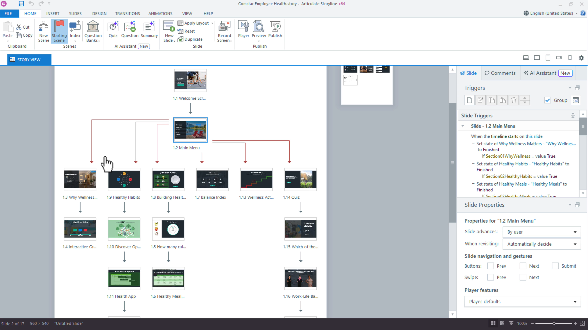
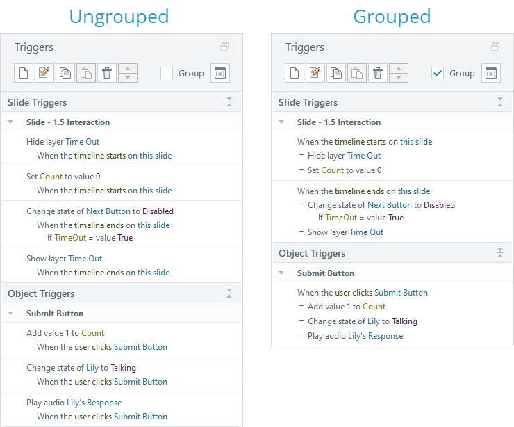
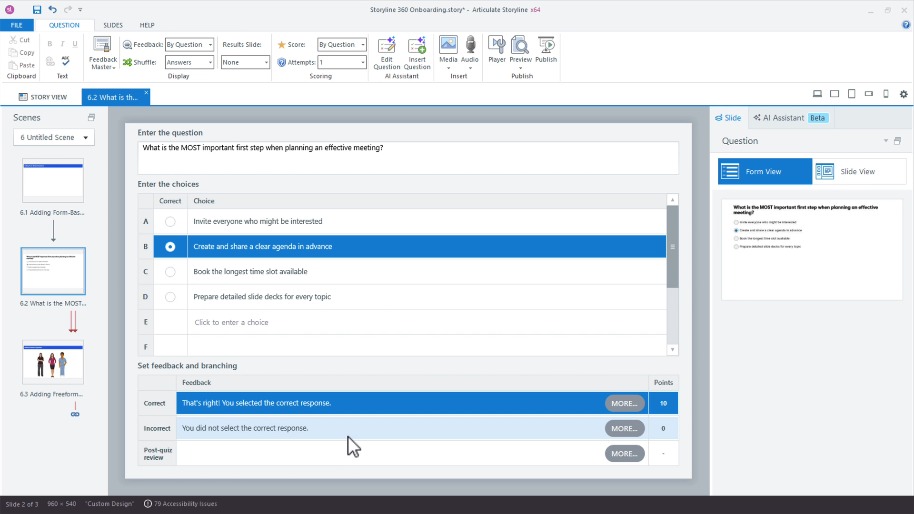

# Activity 08 — Build Branching and Freeform Decisions

**Course:** Mastering Articulate Storyline 360 for e-Learning Content Creation (`TGS-2024042308`)
**Version:** v11 · 17 October 2026

## Scenario

HarbourLink Logistics needs an 8–10 minute annual WSH refresher for frontline warehouse operators, including learners with low reading confidence. Build a picture-first module with short plain-English labels, narration, captions, purposeful interaction, keyboard equivalents and a five-question 80% practice quiz.

## Objective

Create consequence-based decisions and an accessible freeform interaction.

## Supplied files and checkpoint

- Continue from/save as `HarbourLink-WSH-Checkpoint-08-YourName.story`.
- Shared runnable assets are under `../source/`.
- A completed `.story` solution is not supplied; build and test the project in Storyline 360 on Windows.

## Detailed procedure

1. Open HarbourLink-WSH-Checkpoint-07 and Save As HarbourLink-WSH-Checkpoint-08-YourName.story.
2. In existing scene `03 Practise`, open storyboard placeholder `WSA-210 Spill Decision`; do not create a duplicate ID.
3. Create three choice buttons and three Dialog consequence layers; add choice-click Show layer triggers for this ungraded branch prototype.

*Figure 8.1 — Step 3: Story View branching map. Authentic Articulate tutorial/product guidance; example values may differ, so verify the named control in your own checkpoint.*

4. Create or open placeholder `WSA-220 Reconvergence`; add Continue triggers from each consequence layer to WSA-220 and test all three paths.
5. Duplicate WSA-210 so the working ungraded branch remains a rollback reference.

*Figure 8.2 — Step 5: Grouped branch triggers. Authentic Articulate tutorial/product guidance; example values may differ, so verify the named control in your own checkpoint.*

6. On the duplicate, delete every old choice-click Show layer, Jump, and feedback trigger before conversion.
7. Select the three decision objects and choose Insert > Convert to Freeform > Pick One.
8. In Form View assign each object to its response and mark the approved control as correct.

*Figure 8.3 — Step 8: Authentic Form View: response choices, correct radio and feedback fields. Authentic Articulate tutorial/product guidance; example values may differ, so verify the named control in your own checkpoint.*

9. Use the interaction Submit button; do not reveal feedback or navigate when a choice is merely clicked.
10. Edit the generated Correct, Incorrect, and Try Again layers with plain-English consequence and next action.
11. Set attempts and feedback behaviour in Question Tools — Design; keep Try Again only while another attempt remains.
12. Add Continue from submitted feedback to `WSA-220 Reconvergence`.
13. Open Focus Order and place prompt, choices, Submit, and feedback controls in logical order.
14. Preview without Submit, then submit correct, incorrect, and retry paths; confirm scoring and reconvergence.
15. Save and capture the original branch, cleaned duplicate triggers, Form View, feedback layers, score, and reconvergence.

## Evidence to retain

Retain the named .story checkpoint, the completed self-check table and one screenshot for each task showing the final state or setting that proves the acceptance criteria.

## Acceptance criteria

- [ ] All branches reach feedback and continuation.
- [ ] Freeform scoring matches the specification.
- [ ] Feedback explains consequence.
- [ ] Equivalent keyboard route is complete.

## Reflection prompts

- Which storyboard or audience requirement drove your most important decision?
- Which Storyline panel, trigger or setting proves that decision is implemented?
- What accessibility, rights or publishing evidence must accompany the finished project?
