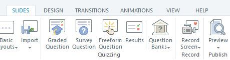
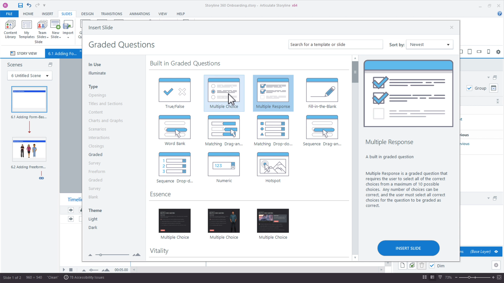
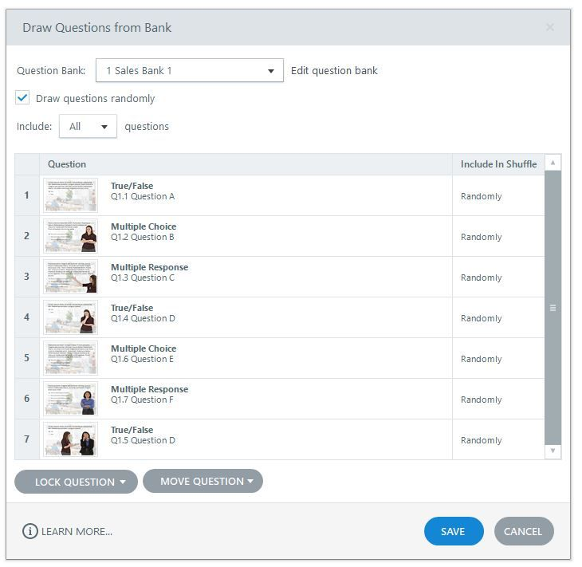
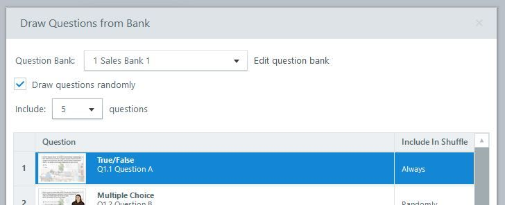

# Activity 09 — Build the Safety Question Bank and Quiz

**Course:** Mastering Articulate Storyline 360 for e-Learning Content Creation (`TGS-2024042308`)
**Version:** v11 · 17 October 2026

## Scenario

HarbourLink Logistics needs an 8–10 minute annual WSH refresher for frontline warehouse operators, including learners with low reading confidence. Build a picture-first module with short plain-English labels, narration, captions, purposeful interaction, keyboard equivalents and a five-question 80% practice quiz.

## Objective

Create a five-question graded quiz with controlled bank coverage and 80% pass.

## Supplied files and checkpoint

- Continue from/save as `HarbourLink-WSH-Checkpoint-09-YourName.story`.
- Shared runnable assets are under `../source/`.
- A completed `.story` solution is not supplied; build and test the project in Storyline 360 on Windows.

## Detailed procedure

1. Open HarbourLink-WSH-Checkpoint-08 and Save As HarbourLink-WSH-Checkpoint-09-YourName.story; in existing scene `04 Quiz`, open placeholder `WSA-301 Safety Quiz`.
2. Choose Slides > Question Banks > Create Question Bank; name it `Safety Bank`.

*Figure 9.1 — Step 2: Slides ribbon > Question Banks. Authentic Articulate tutorial/product guidance; example values may differ, so verify the named control in your own checkpoint.*

3. Create five graded items: hazard recognition, control selection, reporting, emergency action and PPE.
4. For each item open Form View and enter the prompt, choices and correct response from `activities/source/quiz-content.md`.

*Figure 9.2 — Step 4: Authentic Insert Slide > Graded Questions gallery. Authentic Articulate tutorial/product guidance; example values may differ, so verify the named control in your own checkpoint.*

5. Set points consistently and define attempts before styling.
6. Write Correct/Incorrect/Try Again feedback that names the safety consequence.
7. For multiple-response items add `Select all that apply` and use perceivable response states.
8. Tag item titles with the criterion name so coverage is auditable.
9. Choose Slides > Question Banks > New Draw from Question Bank; select `Safety Bank`, then replace the WSA-301 placeholder content with this draw slide so the Quiz menu entry opens the bank draw.

*Figure 9.3 — Step 9: New Draw from Question Bank dialog. Authentic Articulate tutorial/product guidance; example values may differ, so verify the named control in your own checkpoint.*

10. Enable Draw questions randomly, set Include to five, and mark every required criterion Always in Include in Shuffle.

*Figure 9.4 — Step 10: Include five; Always/Randomly shuffle controls. Authentic Articulate tutorial/product guidance; example values may differ, so verify the named control in your own checkpoint.*

11. Open Focus Order for a representative item and remove decorative objects.
12. Preview two different answer sets and record expected raw score.
13. Verify no correct answer is exposed before Submit.
14. Review at phone-width player size for target spacing and readable feedback.
15. Save and capture bank contents, draw settings and one complete feedback path.

## Evidence to retain

Retain the named .story checkpoint, the completed self-check table and one screenshot for each task showing the final state or setting that proves the acceptance criteria.

## Acceptance criteria

- [ ] Five criteria are covered.
- [ ] Scoring is reproducible.
- [ ] Instructions and states are accessible.
- [ ] Answers are not leaked before submission.

## Reflection prompts

- Which storyboard or audience requirement drove your most important decision?
- Which Storyline panel, trigger or setting proves that decision is implemented?
- What accessibility, rights or publishing evidence must accompany the finished project?
