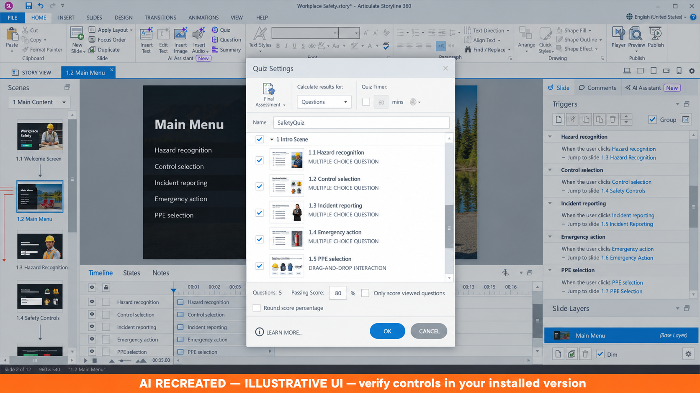
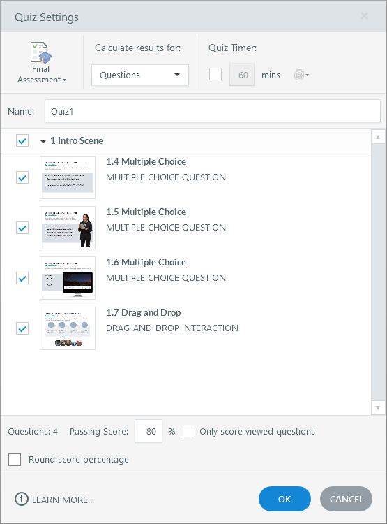
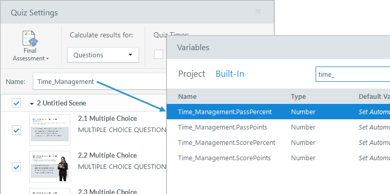

# Activity 10 — Configure Results, Retry and Completion

**Course:** Mastering Articulate Storyline 360 for e-Learning Content Creation (`TGS-2024042308`)
**Version:** v11 · 17 October 2026

## Scenario

HarbourLink Logistics needs an 8–10 minute annual WSH refresher for frontline warehouse operators, including learners with low reading confidence. Build a picture-first module with short plain-English labels, narration, captions, purposeful interaction, keyboard equivalents and a five-question 80% practice quiz.

## Objective

Track only the scored quiz, set 80% pass and prove retry/review behaviour.

## Supplied files and checkpoint

- Continue from/save as `HarbourLink-WSH-Checkpoint-10-YourName.story`.
- Shared runnable assets are under `../source/`.
- A completed `.story` solution is not supplied; build and test the project in Storyline 360 on Windows.

## Detailed procedure

1. Open checkpoint 09 and Save As checkpoint 10.
2. Choose Slides > Results; create a graded Results slide and name its quiz `SafetyQuiz`.
3. Open Result Tools — Design > Quiz Settings and select only the `Safety Bank` question-draw slide; do not select its five bank questions as separate direct rows.
4. In Result Tools — Design set Quiz Type to `Final Assessment`; then open Quiz Settings and confirm the `Safety Bank` draw is the only scored source.

*Figure 10.1 — Step 4: AI RECREATED direct-question tracking example; select the Safety Bank draw and Final Assessment for this activity. AI RECREATED illustrative orientation; example values may differ, so verify the named control in your own checkpoint.*

*Figure 10.2 — Step 4: Result Tools — Design > Quiz Settings and Final Assessment. Authentic Articulate tutorial/product guidance; example values may differ, so verify the named control in your own checkpoint.*

5. Set Passing Score to `80%`; confirm visible score uses SafetyQuiz.ScorePercent.

*Figure 10.3 — Step 5: SafetyQuiz result variables. Authentic Articulate tutorial/product guidance; example values may differ, so verify the named control in your own checkpoint.*

6. Choose Result Tools — Design > Retry Button and Review Button so Storyline creates the built-in Reset results and Review results behaviour.
7. On Retry add Reset results for this result slide before Jump to the first quiz slide.
8. Confirm relevant question states reset while permitted course progress remains.
9. Keep Review unavailable until the attempt is submitted.
10. Choose Home > Publish > LMS/LRS > Reporting and Tracking; select the SafetyQuiz Results slide as the only tracking criterion.

*Figure 10.4 — Step 10: AI RECREATED Tracking tab: SafetyQuiz as sole completion criterion. AI RECREATED illustrative orientation; example values may differ, so verify the named control in your own checkpoint.*

11. Do not add slides viewed because multiple criteria are OR and could bypass the quiz.
12. Test 3/5=60% fail and record state.
13. Test 4/5=80% pass and record state.
14. Test 5/5=100%, retry, review and relaunch paths.
15. Compare visible score/pass with the result variables and expected LMS state.
16. Save and capture Quiz Settings, Retry trigger order and pass/fail runtime screens.

## Evidence to retain

Retain the named .story checkpoint, the completed self-check table and one screenshot for each task showing the final state or setting that proves the acceptance criteria.

## Acceptance criteria

- [ ] 80% threshold is exact.
- [ ] Slides viewed cannot bypass the quiz.
- [ ] Retry starts a clean quiz attempt.
- [ ] Review appears only after submission.

## Reflection prompts

- Which storyboard or audience requirement drove your most important decision?
- Which Storyline panel, trigger or setting proves that decision is implemented?
- What accessibility, rights or publishing evidence must accompany the finished project?
