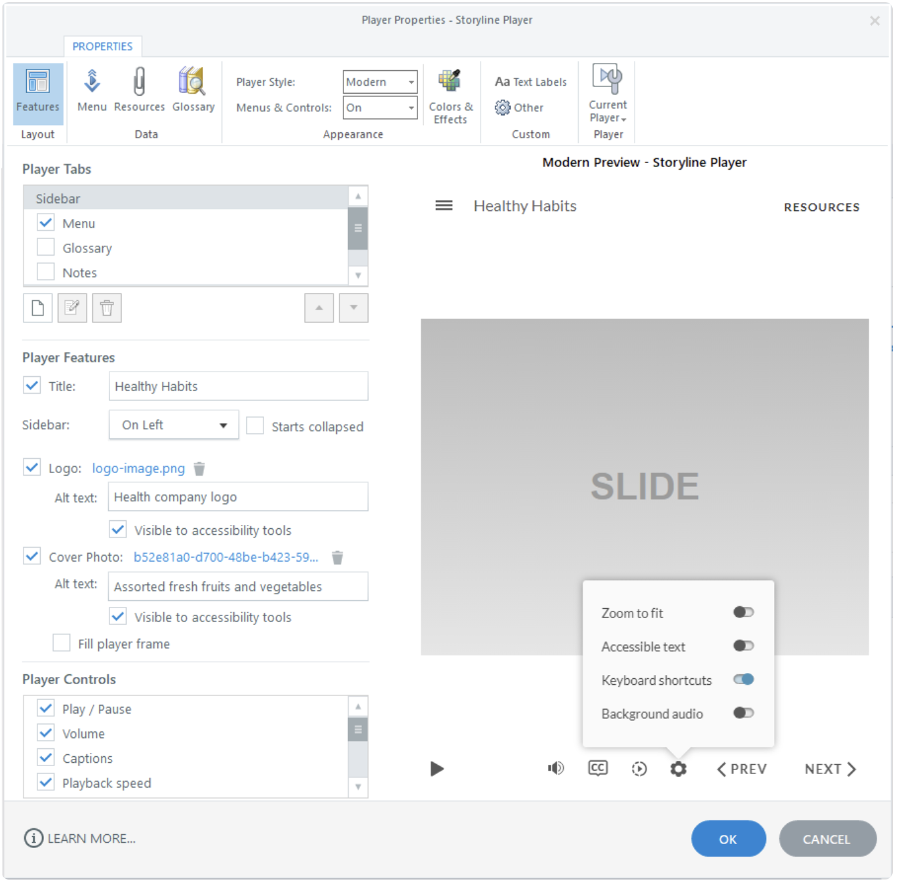

# Activity 11 — Configure Player, Translation and Review 360

**Course:** Mastering Articulate Storyline 360 for e-Learning Content Creation (`TGS-2024042308`)
**Version:** v11 · 17 October 2026

## Scenario

HarbourLink Logistics needs an 8–10 minute annual WSH refresher for frontline warehouse operators, including learners with low reading confidence. Build a picture-first module with short plain-English labels, narration, captions, purposeful interaction, keyboard equivalents and a five-question 80% practice quiz.

## Objective

Prepare the module for accessible review and localisation.

## Supplied files and checkpoint

- Continue from/save as `HarbourLink-WSH-Checkpoint-11-YourName.story`.
- Shared runnable assets are under `../source/`.
- A completed `.story` solution is not supplied; build and test the project in Storyline 360 on Windows.

## Detailed procedure

1. Open `HarbourLink-WSH-Checkpoint-10-YourName.story` from the previous activity and immediately use File > Save As to create `HarbourLink-WSH-Checkpoint-11-YourName.story` on a local Windows drive. Preserve the prior checkpoint; no completed .story solution is supplied.
2. Open `source/storyboard.csv` and the previous checkpoint, then confirm the screen IDs and acceptance criteria before editing.
3. Open Player Properties and enable only required controls, including volume and captions; verify player focus and labels.

*Figure 11.1 — Step 3: Player feature and accessibility controls. Authentic Articulate tutorial/product guidance; example values may differ, so verify the named control in your own checkpoint.*

4. Choose File > Localization > XLIFF/Word Translation > Export to Word or Export to XLIFF; inspect protected variables/object IDs, then use the same path > Import into a duplicate source and verify representative layouts.
5. Publish a versioned Review 360 item or, if credentials are unavailable, complete the supplied settings worksheet without claiming upload.
6. Define reviewers, review questions, due date, comment owner and accept/adapt/reject disposition.
7. Retain the Review item/version identifier or the honest offline plan.

## Evidence to retain

Retain the named .story checkpoint, the completed self-check table and one screenshot for each task showing the final state or setting that proves the acceptance criteria.

## Acceptance criteria

- [ ] Player controls are keyboard accessible.
- [ ] Translation workflow protects logic identifiers.
- [ ] Review ownership is explicit.
- [ ] No upload is claimed without readback.

## Reflection prompts

- Which storyboard or audience requirement drove your most important decision?
- Which Storyline panel, trigger or setting proves that decision is implemented?
- What accessibility, rights or publishing evidence must accompany the finished project?
