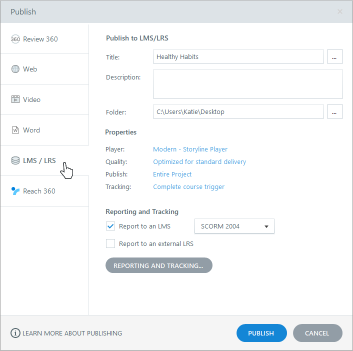
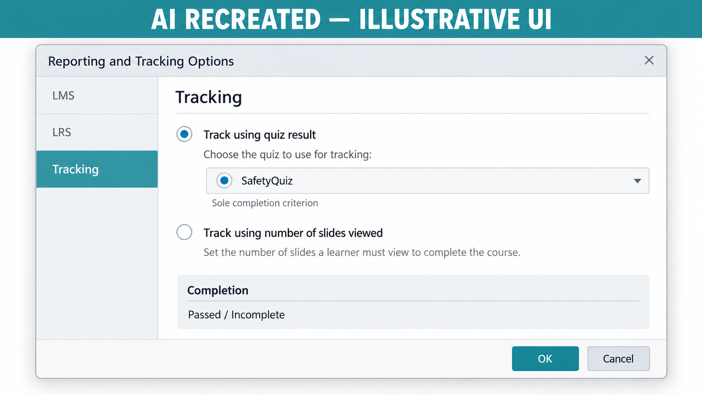

# Activity 12 — Publish and Test SCORM 1.2 and 2004

**Course:** Mastering Articulate Storyline 360 for e-Learning Content Creation (`TGS-2024042308`)
**Version:** v11 · 17 October 2026

## Scenario

HarbourLink Logistics needs an 8–10 minute annual WSH refresher for frontline warehouse operators, including learners with low reading confidence. Build a picture-first module with short plain-English labels, narration, captions, purposeful interaction, keyboard equivalents and a five-question 80% practice quiz.

## Objective

Create root-correct SCORM packages and verify runtime behaviour in a sandbox.

## Supplied files and checkpoint

- Continue from/save as `HarbourLink-WSH-Checkpoint-12-YourName.story`.
- Shared runnable assets are under `../source/`.
- A completed `.story` solution is not supplied; build and test the project in Storyline 360 on Windows.

## Detailed procedure

1. Open checkpoint 11 and Save As checkpoint 12.
2. Choose Home > Publish > LMS/LRS; set the title and a local publish folder.

*Figure 12.1 — Step 2: Home > Publish > LMS/LRS. Authentic Articulate tutorial/product guidance; example values may differ, so verify the named control in your own checkpoint.*

3. Open Reporting and Tracking; select `SCORM 1.2`.
4. Select the target LMS reporting status pair and record it; track the quiz Results slide only.

*Figure 12.2 — Step 4: AI RECREATED Tracking tab: SafetyQuiz only; verify current UI. AI RECREATED illustrative orientation; example values may differ, so verify the named control in your own checkpoint.*

5. Set a stable identifier and retain it in the release record.
6. Publish locally; on Publish Successful choose ZIP.
7. Open the ZIP and confirm `imsmanifest.xml` and launch files are at archive root, without an extra wrapper folder.
8. Repeat Home > Publish > LMS/LRS and choose the LMS-supported SCORM 2004 edition.
9. Record SCORM 2004 completion, success and score settings separately.
10. Upload only to an approved sandbox with a fresh learner attempt.
11. Launch and test 3/5 fail; read back status and score.
12. Launch and test 4/5 pass; read back completion, success and score.
13. Bookmark, close and relaunch; verify location, suspend data and session time.
14. Compare the supplied runtime demo only for API/status/relaunch structure; label it not Storyline output.
15. Save both ZIP checksums and one screenshot per package showing final reporting/tracking settings.

## Evidence to retain

Retain the named .story checkpoint, the completed self-check table and one screenshot for each task showing the final state or setting that proves the acceptance criteria.

## Acceptance criteria

- [ ] Two distinct packages and setting records exist.
- [ ] Manifest is at archive root.
- [ ] Score/status/resume read back in sandbox.
- [ ] Reference boundary is stated accurately.

## Reflection prompts

- Which storyboard or audience requirement drove your most important decision?
- Which Storyline panel, trigger or setting proves that decision is implemented?
- What accessibility, rights or publishing evidence must accompany the finished project?
